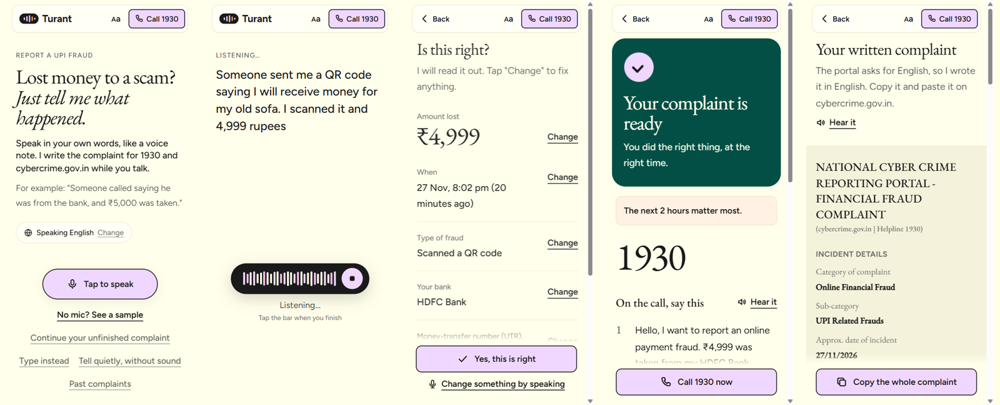

# Turant: report a UPI fraud by voice, in the golden hour

**Live:** https://turant-voice.vercel.app · **Run it yourself:** `docker compose up`, then open http://localhost:3000
Theme: *Public infrastructure and civic services* (Build for Bharat, Scaler × Wispr Flow, Round 2)



Demo video (1:52, a real Hindi voice going through the live app): [`demo/turant_demo_landscape.mp4`](demo/turant_demo_landscape.mp4)

Someone has just lost money to a UPI scam. The money can still be frozen if it is reported within the first hour or two, but reporting means a 1930 call queue or the cybercrime.gov.in form: an OTP login, a captcha, and a 200-character description with the bank, UTR, date and amount typed in English.

Turant turns that into a conversation. You tap once and say what happened in your own words, for example: *"Someone called from customer care, made me install AnyDesk, and two lakh rupees went from my ICICI account yesterday at 7 pm."* Turant then:

1. **Writes the complaint while you talk.** It picks out the amount, time, type of scam, bank, payment app, UTR and the fraudster's UPI ID, phone or account number.
2. **Asks only for what is missing,** one short question at a time ("Please read the 12-digit UTR number from the bank SMS"). Each answer is spoken, or typed or tapped if you prefer.
3. **Reads it back** ("Is this right?") so you can change anything by voice.
4. **Hands you what to do next:** a script to read to the 1930 operator, the complaint text in the order the cybercrime.gov.in portal asks for it, a message for your bank, and a checklist.

No account, no Turant server, and the complaint never leaves the device unless you copy or share it. The understanding (rules) runs on the device. One caveat on audio: when the browser's built-in speech recognition is used (Chrome / Edge), the browser maker may process the audio on its servers. The in-page Whisper fallback keeps audio on the device.

## Try it in one minute

- **No microphone?** Tap **"No mic? See a sample"** to watch a recorded story go through the same pipeline as real speech.
- **With a microphone:** tap **"Tap to speak"**, tell a short fraud story, then stop talking (or tap the black bar).
- **Browsers:** Chrome or Edge on a laptop or Android phone. The microphone needs HTTPS or `localhost`.

## Why voice, and why now

- **Losses:** Indians reported losing **₹22,845 crore to cyber fraud in 2024**, across **36 lakh** financial-fraud incidents (MoS Home, Lok Sabha, Jul 2025). In 2025 it was ₹22,495 crore across 24 lakh complaints.
- **Speed works:** the 1930 / CFCFRMS system has held back **₹11,158 crore** in **32.8 lakh** complaints (to 30 Jun 2026). Police describe a "golden hour": victims who report within about 1-3 hours are the ones whose money can still be frozen.
- **Reporting is slow and English-heavy:**
  - **1930 calls:** each complaint takes about 16-18 minutes to register by hand (Bihar).
  - **The portal:** it asks for typed details, a UTR and an ID upload.
  - **Official plans:** the Home Minister has directed an AI and multi-language revamp of 1930 (Jun 2026).
- **Who uses Indian languages:** 98% of India's 886 million internet users use the internet in Indian languages (IAMAI-Kantar 2024).
- **Elderly victims:** senior citizens filed 4% of complaints but lost about 18% of the money (2025).

Sources with links: [`research/facts.md`](research/facts.md).

## How the voice works

```
microphone ──► browser speech recognition (Chrome / Edge, live words)
     │                 │  returns nothing, or ends early?
     │                 ▼
     └──► our own recorder + voice detection ──► Whisper in the page (transformers.js, on-device)
                                   │
                                   ▼
             rule-based extractor (7 languages) ──► one question at a time ──► read-back ──► complaint
```

- **Two speech recognisers:**
  - The browser's own speech recognition gives live words when it works.
  - Turant also records the audio itself. If the browser returns nothing, returns a single misheard word or ends early (all seen with Chrome on Windows), Whisper reads the recording **inside the page**. This path uploads no audio.
  - **The in-page model depends on the speaking language:**
    - Hindi, English (India) and Marathi use **Whisper-Hindi2Hinglish-Swift** (Oriserve, Apache-2.0), which writes clean Hinglish.
    - Bengali uses a Bangla whisper-small fine-tune (arif11/bangla-ASR-v5, Apache-2.0); Telugu and Kannada use IIT Madras's **IndicWhisper** base fine-tunes (vasista22, Apache-2.0), converted to ONNX by `harness/convert_whisper.py` and served with the site from `/models/`. Tamil stays on whisper-base for now (see below).
  - **Download and speed:** about 100 MB (Bengali 287 MB), downloaded once and then cached. A 12-second story transcribes in about 8 seconds on a laptop: cross-origin isolation lets it use several CPU threads.
  - Turant's own voice detection decides when the person has finished, so a recogniser that gives up early can't cut them off.
  - Add `?speech=whisper` to the link to skip the browser recogniser and use only the in-page path.
- **Understanding is rules, not an LLM.** On the same transcripts, an LLM invented times and scam types. On its own it was fully correct on 16.5% of reports, against 43.5% for the rules at the time (see `harness/JOURNAL.md`). The rules read numbers, dates, banks and IDs in **Hindi, English/Hinglish, Bengali, Tamil, Telugu, Marathi and Kannada**, including the misspellings speech recognisers make:
  - "पाँच हज़ार" = ₹5,000.
  - "to lock rupees" = ₹2,00,000.
  - "9 बजकर 30 मिनट" = 9:30.
  - A UTR read out digit by digit.
- **Asking beats guessing.** A wrong amount on a police complaint is worse than a missing one. A spoken "₹5" (where "thousand" was probably lost) is offered back as "₹5,000?", and an unclear value is asked again rather than written in.
- **UI:** English text, with a choice of *speaking* language. The look is in the style of Wispr Flow's website: cream paper, a serif headline, lilac buttons, and a black waveform bar while recording.

## How well it works (measured, reproducible)

The `harness/` turns written fraud reports into speech with Indian neural voices (edge-tts). It adds noise (pink, babble and traffic, at 15 and 5 dB), runs the speech through Whisper, then scores every field the extractor fills.

| Fully correct reports (every field right, nothing spurious) | Whisper turbo | Whisper large-v3 |
|---|---|---|
| Tuning corpus, clean speech (280 cases, 7 languages) | 54.5% | 69.5% |
| Voices never used for tuning | 53.4% | 67.8% |
| **Blind set: 84 new sentences written after tuning, never tuned on** | **52.2%** | **62.8%** |
| Reference text (no speech recognition) | 100% | 100% |

- **By language** (large-v3, clean): Hindi 98%, English 90%, Marathi 70%, Tamil 66%, Telugu 61%, Kannada 46%, Bengali 44%.
- **Where the errors are:** about 92% of the remaining errors are the recogniser losing words, mostly in Bengali and Kannada, not the parsing. The rules alone can reach at most about 71% on these transcripts.
- **What ships in the page** (`harness/asr_wbase.mjs` runs the app's own in-page models on the same clips; clean, fully correct reports):

  | In-page model | Hindi | English | Marathi | Bengali / Tamil / Telugu / Kannada |
  |---|---|---|---|---|
  | whisper-base | 13.8% | 50.0% | 10.0% | 2.5-6.3% |
  | **Hindi2Hinglish-Swift + rules tuned to its Hinglish** | **90.0%** | **75.0%** | **53.8%** (held-out voice 40.0%) | not used |
  | **Indian-language Whisper fine-tunes** (Bangla small; IndicWhisper Telugu / Kannada base) | | | | **Bengali 36.3%, Telugu 68.8%, Kannada 50.0%** (Tamil small: 47.5%, measured, not shipped) |

  On the **blind set** (new sentences, never tuned on), the in-page model gets Hindi **91.7%** (the same as the text-only ceiling for those sentences), English 61.1% and Marathi 41.7%. In noise, Hindi stays at 85.0% at 15 dB (a busy room) and 55.0% at 5 dB (a roadside).
  The Indian-language models were measured on both voices with no rule changes. Telugu and Kannada in the page now beat server Whisper large-v3 (61% and 46%). Tamil's model works (6.3% → 47.5%) but its 196 MB file is over the host's 100 MB per-file limit, so it waits for Hugging Face hosting. The Telugu and Kannada files are not in git: a fresh `docker compose up` uses whisper-base for them; `harness/convert_whisper.py` rebuilds them.
- **Fuzz testing:** millions of generated amounts and times are parsed 100% correctly. With one recogniser-style slip per number, 99.6-100% are still read correctly.
- **Tests:** 159 unit tests in the app, 126 in the parsers and 261 in the voice kit.
- **Lighthouse** (mobile, live site, 27 Nov): accessibility 100, best practices 100, SEO 100, performance 94 (first paint 2.0 s on a throttled phone connection). Fonts are self-hosted, so the page loads with no third-party requests (the in-page speech model is fetched from Hugging Face only when it is needed).

The full log of every tuning round, what changed and what it gained is in [`harness/JOURNAL.md`](harness/JOURNAL.md).

## Run and develop

```bash
docker compose up                # http://localhost:3000, no keys or .env needed (.env.example lists the optional port)

# or, for development
cd prototype
npm install
npm run dev                      # http://localhost:5173
npm test                         # unit tests
```

Re-run the speech evaluation (needs Python, edge-tts and a Whisper server; see `harness/README.md`): `cd harness && node run_eval.mjs --name x`.

## What is in this repository

| Folder | What |
|---|---|
| `prototype/` | **The app** (React + TypeScript + Vite PWA, works offline): extraction rules, the question flow, outputs, and the in-page Whisper fallback. |
| `harness/` | Speech-to-report evaluation: corpus (280 cases plus an 84-case blind set), TTS, noise, ASR, scoring and the tuning journal. |
| `round2-kit/indic-numbers/` | Shared parsers for numbers, times and banks in 7 languages, with fuzz tests. |
| `round2-kit/voice-kit/` | The same voice engine as a reusable kit, where one config file makes a new slot-filling voice app (examples: khata ledger, health, civic grievance). |
| `research/` | Sourced facts, voice-UX and accessibility research, and the design spec. |
| `round1/` | Our Round 1 submission (idea, build prompt, impact). |

## Dependencies and their risks

| Dependency | Used for | If it gets costly or disappears |
|---|---|---|
| Browser speech recognition (Chrome / Edge) | Live words while speaking | Free. It already fails on some machines, and the in-page Whisper takes over. |
| Whisper via transformers.js + ONNX Runtime Web (open source); models from Hugging Face (whisper-base; Oriserve Hindi2Hinglish-Swift, Apache-2.0) | On-device speech recognition fallback | Free and open source. The model files can be self-hosted next to the app. |
| Hosting (Vercel now; any static host or the Docker image) | Serving the app | Static files only, so near-zero cost. |
| Better Indian-language ASR (planned: Bhashini / AI4Bharat IndicConformer / Sarvam) | Bengali, Kannada, Tamil and Telugu accuracy | Behind one small interface (`src/lib/speech.ts`), so the provider can be swapped without touching the screens. |

## Honest limitations

- **Speech accuracy:** Bengali and Kannada are still weak. That's the recogniser, and the next step is an Indian-language ASR.
- **Whisper fallback:** the first use downloads about 100 MB. Live words appear only when the browser's own recogniser works. Tamil's in-page fallback is still weak (whisper-base, 6.3%), so Tamil relies on the browser's recogniser for now.
- **Filing:** Turant prepares the complaint and the call script. Filing still happens on the official 1930 line or cybercrime.gov.in, which have no public API.
- **Test speech:** our harness voices are synthetic (edge-tts). Real phone tests in each language are the next step.

## Team

Shubh Saxena and Sugandhi Agrawal ("Shubh's team"), Build for Bharat 2026.
